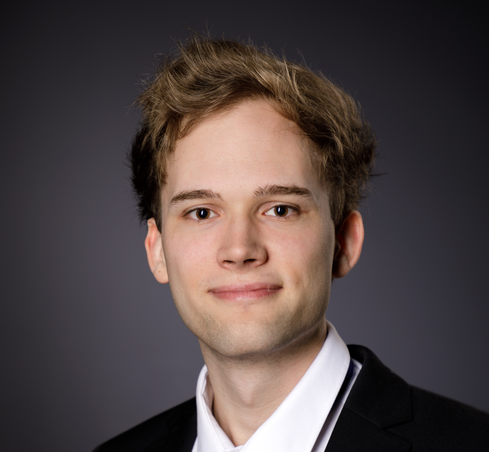

## Summary
I'm a Fullstack & DevOps Software Engineer based in the Zurich area with over 5 years of professional experience in backend, frontend and cloud development. I hold a Master's in Computer Science from TU Darmstadt and a Bachelor's from HTWK Leipzig.
Originally from the Leipzig area, I moved to Switzerland after graduating. After 2.5 years as a software engineer at Adcubum AG, I now work as a Fullstack & DevOps Engineer Consultant at ERNI AG.

---
## Experience

With over 5 years of professional experience, I have worked across the full software development lifecycle — from backend and frontend development to DevOps and CI/CD.

<table style="width:100%; border-collapse:collapse; background:var(--surface); border:1px solid var(--border); border-radius:8px; overflow:hidden;">
  <thead>
    <tr>
      <th style="padding:0.85rem 1rem; color:var(--accent); background:rgba(var(--accent-rgb),0.1); border-bottom:1px solid var(--border);">When</th>
      <th style="padding:0.85rem 1rem; color:var(--accent); background:rgba(var(--accent-rgb),0.1); border-bottom:1px solid var(--border);">Role</th>
      <th style="padding:0.85rem 1rem; color:var(--accent); background:rgba(var(--accent-rgb),0.1); border-bottom:1px solid var(--border);">Company</th>
    </tr>
  </thead>
  <tbody>
    <tr>
      <td style="padding:0.85rem 1rem; color:var(--text-main); border-bottom:1px solid var(--border);">2025 – today</td>
      <td style="padding:0.85rem 1rem; color:var(--text-main); border-bottom:1px solid var(--border);">Fullstack & DevOps Engineer Consultant</td>
      <td style="padding:0.85rem 1rem; color:var(--text-main); border-bottom:1px solid var(--border);">ERNI AG, Zurich</td>
    </tr>
    <tr>
      <td style="padding:0.85rem 1rem; color:var(--text-main); border-bottom:1px solid var(--border);">2024 – 2025</td>
      <td style="padding:0.85rem 1rem; color:var(--text-main); border-bottom:1px solid var(--border);">Software Engineer – Framework Team</td>
      <td style="padding:0.85rem 1rem; color:var(--text-main); border-bottom:1px solid var(--border);">Adcubum AG, Zurich</td>
    </tr>
    <tr>
      <td style="padding:0.85rem 1rem; color:var(--text-main);">2022 – 2024</td>
      <td style="padding:0.85rem 1rem; color:var(--text-main);">Software Engineer – Business Developer</td>
      <td style="padding:0.85rem 1rem; color:var(--text-main);">Adcubum AG, Zurich</td>
    </tr>
  </tbody>
</table>

**At ERNI AG**, I am currently working as a Fullstack & DevOps Engineer Consultant on a long-term project.

**At Adcubum AG**, I first designed and developed new features for a car insurance product, including premium calculations and data exchange with partner insurers. I led the design and implementation of a modularization based on Domain-Driven Design. Later, I moved to the Framework Team, where I built a core framework used across multiple insurance products and drove the modernization to Spring Boot 3 with new CI/CD pipelines.

Before that, I gained early hands-on experience as a **working student web developer** at Huck IT in Darmstadt, building a room reservation system with Vue.js. During my Bachelor's, I completed an **internship at Apinauten GmbH** in Leipzig, where I worked on modularizing and containerizing a Backend-as-a-Service platform. I also worked as a **software tester** at Gesundheitsforen Leipzig, developing end-to-end tests with Selenium.

My core tech stack includes **Java**, **Spring Boot**, **Angular**, **Kubernetes/OpenShift**, and **CI/CD** with ArgoCD, Tekton, and Jenkins. I hold certifications including **Oracle Certified Java Developer**, **Spring Professional Developer**, **CKAD**, **iSAQB CPSA-F**, **AWS Certified Cloud Practitioner**, and **Azure Fundamentals**.

I studied Computer Science at **HTWK Leipzig** (BSc) and **TU Darmstadt** (MSc), with a focus on Software Architecture and Deep Learning. Alongside my job, I'm currently a guest student at the **Technical University of Munich (TUM)**, attending several advanced computer science modules.

Beyond my day-to-day work, I regularly attend **Java User Group** meetups and participate in **Hackergarten** events — contributing to open-source projects and staying connected with the developer community.

For a full overview of my career and recommendations, visit my [LinkedIn profile](https://www.linkedin.com/in/hendrik-schick/).

---
## About this website
I write about software engineering topics from my work and my own projects — mostly Java, along with other areas of computer science.

I also offer software development and consulting services. For enquiries, see the [contact page](/contact/).
